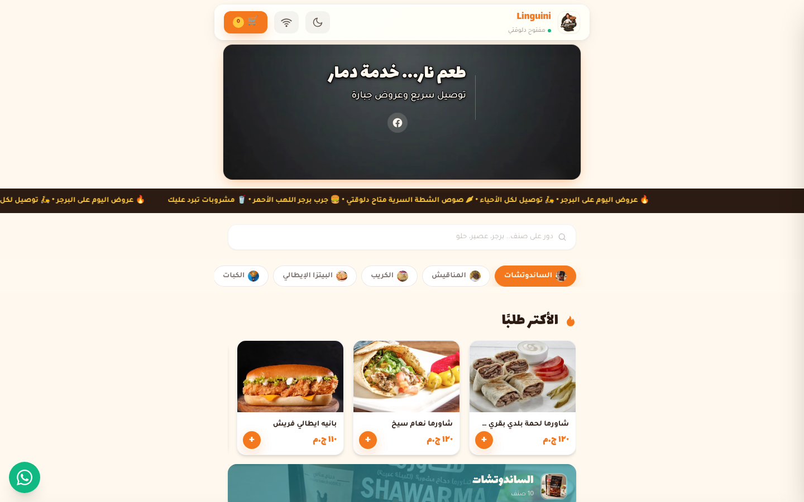

# 🍕 Linguini

**A live digital menu built for a real, working restaurant.**

## 📖 Overview

Linguini is a complete digital menu built for a real, working restaurant. Guests browse an organized menu of sandwiches, manaqish, crepes and more — every item with a photo, price and customer rating — then build their order in a cart and check out in seconds. A live ticker of daily offers, a most-ordered section and a built-in dark mode make it feel like a product, not a PDF.

## ✨ Features

- 🍽️ **Full categorized menu** — photos, prices and ratings for every dish
- 🛒 **Cart-based ordering flow** — quantity control and live totals
- 🔥 **Daily offers ticker** and a most-ordered section synced with real service
- 🔍 **Instant search** across the entire menu
- 📱 **WhatsApp integration** and dark mode for late-night cravings

## 🧱 Tech Stack

`Next.js` · `React` · `Realtime` · `Arabic RTL`

## 🌐 Live Product

**Try it now:** [https://el-atshan.vercel.app/](https://el-atshan.vercel.app/)

---

Built by **[Hamza Talal](https://github.com/{USERNAME})** — 15-year-old full-stack developer from Egypt

